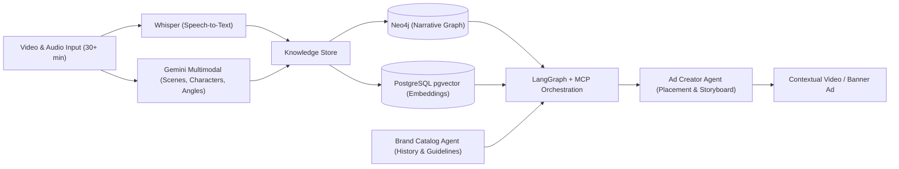
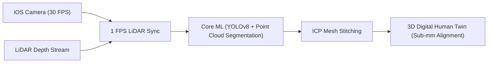

<div align="center">

# Sanket Dhuri

**AI Engineer** | Multimodal Systems, Autonomous Agents & Computer Vision  
Pune, Maharashtra, India

[](https://www.linkedin.com/in/sanket-dhuri-0b155815a/)
[](mailto:sanketdhuri360@outlook.com)
[](https://github.com/spdraptor)

</div>

---

### About

I build production AI systems across two main tracks: multi-agent LLM applications and on-device computer vision. Over the past 4+ years at **Rezolve.ai** and **Ciklum India**, I have taken ideas from early prototypes to live deployments: GraphRAG video pipelines, self-hosted vLLM backends, iOS Core ML models, and blueprint extraction tools.

* **Currently:** AI Engineer at **Rezolve.ai** (building multimodal agents, GraphRAG pipelines, and mentoring junior developers).
* **Previously:** AI/ML Engineer at **Ciklum India** (Star Employee of the Year 2023 & 2024, Best Team Award 2022).
* **Focus Areas:** LangGraph, Model Context Protocol (MCP), GraphRAG (Neo4j + PostgreSQL pgvector), self-hosted LLMs (vLLM / Ollama), and Edge CV (Core ML / LiDAR).

---

### How I Architect Systems

#### 1. Multimodal Video Analysis & Contextual Ad Pipeline
Built to replace jarring, off-topic mid-roll ads with context-aligned creatives. Processes 30-minute video streams in **4-5 minutes (quick scan)** and **9-10 minutes (deep analysis)**.



#### 2. On-Device iOS 3D LiDAR & Vision Pipeline
Converted PyTorch and YOLOv8 models to Core ML for mobile execution, matching frame processing to LiDAR sensor rates to cut compute overhead by **40%**.



---

### Production Impact

| System | Tech Stack | Measured Outcome |
| :--- | :--- | :--- |
| **Multimodal Ad Engine** | LangGraph, MCP, Gemini, Whisper, Neo4j, pgvector | 4-5 min quick scan / 9-10 min deep scan on 30-min video |
| **Hospitality Memory Bot** | vLLM, FastAPI, LangChain, Redis, SQL | Sub-200ms session retrieval across 50+ concurrent sessions |
| **CAD Blueprint Extractor** | Computer Vision, OCR, Python | 96% symbol accuracy; cut review from ~1 week to 25 mins |
| **iOS 3D Digital Twin** | PyTorch, YOLOv8, Core ML, ICP, LiDAR | 40% lower mobile compute draw; sub-millimeter alignment |
| **Dysarthria Speech Tool** | STT, TTS, Voice Cloning | 80% speech intelligibility in original speaker voice |

---

### Technical Stack

```text
Languages & APIs   │ Python, SQL, FastAPI, Flask, REST, WebSockets
LLM & Agent Stack  │ LangGraph, LangChain, MCP, PromptFlow, Gemini, GPT-4o, Claude, LLaMA, Mistral
Serving & Local AI │ vLLM, Ollama, PyTorch, Hugging Face Transformers, Diffusers
Vision & Edge ML   │ Core ML, YOLOv8, CLIP, OCR, 3D Point Clouds, ICP, LiDAR
Audio & Speech     │ Whisper, STT, TTS, Voice Cloning, Voice Conversion
Data & Memory      │ Neo4j (GraphRAG), PostgreSQL (pgvector), Redis, FAISS, Chroma
```

---

### GitHub Activity

<div align="center">


<br/>


<br/>


</div>
